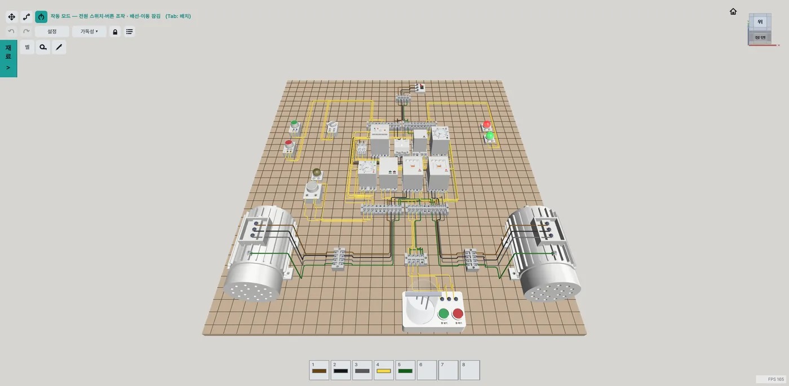

# 전기기능사 3D 시뮬레이터 electric-sim

각종 전기회로를 3D 환경에서 시뮬레이션할 수 있는 Windows 앱입니다. 전기기능사 실기에 쓰는 기구를 판에 놓고, 전선으로 잇고, 전원을 넣어 회로의 동작을 확인합니다.

**[Windows용 다운로드 (zip)](https://github.com/08yejune-creator/electric-sim/releases/latest/download/electric-sim.zip)** · [소개 페이지](https://08yejune-creator.github.io/electric-sim/) · [조작 튜토리얼 PDF](docs/electric-sim-tutorial.pdf) · [모든 릴리스](https://github.com/08yejune-creator/electric-sim/releases)

## 할 수 있는 일

- **배치:** 재료창의 기구를 판에 놓고 옮기거나 돌립니다. 릴레이와 타이머는 소켓에 꽂습니다.
- **배선:** 단자끼리 전선으로 잇습니다. 경유점을 찍어 경로를 정하고, 전선 색은 황·갈·흑·회·녹 중에서 고릅니다.
- **작동:** 전원 스위치, 차단기, 버튼을 조작해 배선한 그대로 회로가 움직이는지 확인합니다.
- **벨 테스터:** 두 단자가 이어져 있는지 프로브로 확인합니다.
- **동작 기록:** 작동 중 일어난 일을 목록과 타임 차트로 보고, 사진이나 PDF로 내보냅니다.
- **종이테이프·네임펜:** 단자대와 기구에 테이프를 붙이고 이름을 적습니다.
- **저장:** 저장, 불러오기, 자동저장, 되돌리기를 지원합니다. 예제 회로 2개(전기기능사 1번회로, 와이델타 기동회로)가 들어 있습니다.

정답을 맞히는 프로그램이 아닙니다. 채점과 과제 모드는 없고, 회로를 자유롭게 만들어 동작을 확인합니다.

## 들어 있는 기구

| 분류 | 기구 |
| --- | --- |
| 차단·보호 | 배선용차단기(MCCB), EOCR, 유리관 퓨즈 홀더 |
| 계전기 | 전자접촉기(MC), 릴레이(X), 타이머(T), 플리커릴레이(FR), 플로트레스 스위치(FLS), FLS 수조 |
| 소켓 | 8P 소켓, 12P 소켓 |
| 조작·표시 | 푸시버튼(녹·적), 셀렉터 스위치(SS), 램프(적·녹·황·백), 부저 |
| 단자대 | 10P+10P, 8P |
| 부하 | 3상 유도전동기(3단자, Y-Δ 기동용 6단자) |

## 실행 방법

1. [electric-sim.zip](https://github.com/08yejune-creator/electric-sim/releases/latest/download/electric-sim.zip)을 받아 압축을 풉니다.
2. `electric-sim.exe`를 실행합니다.

Windows 64비트용입니다. 프로그램을 켜면 새 버전이 있는지 확인하고, 있으면 시작 화면에서 업데이트할 수 있습니다.

## 수집하는 정보

프로그램을 사용하면 익명 사용 통계(접속 시간)와 오류 정보 수집에 동의한 것으로 간주합니다.

## 저장소 안내

이 저장소는 실행 파일 배포용입니다. 소스 코드는 들어 있지 않습니다.
